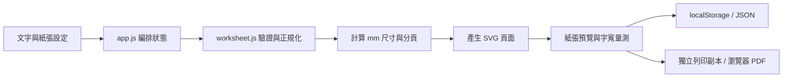

# 架構說明

## 版本與正式入口

Git repository 根目錄是 `Writting_Practise/`。正式網站來源為 `javascript/`，發布檔案為 `javascript/dist/`。`rust/` 保留 Rust/Axum 本機參考版，根目錄 `index.html` 保留最早單檔版本。

## 元件

| 檔案 | 職責 |
| --- | --- |
| `javascript/index.html` | Banner、範本、行列表、編輯器、紙張預覽與設定／格子／列印提示對話框 |
| `javascript/app.css` | 桌面／手機版面、內附字型、紙張縮放及列印媒體樣式 |
| `javascript/worksheet.js` | 無 DOM 的純函式模組；預設資料、嚴格驗證、舊格式轉換、紙張容量與 SVG 產生 |
| `javascript/zhuyin-data.js` | 從原始字型 cmap 提取的字元覆蓋與多音字 IVS 對應，保留上游字型授權 |
| `javascript/chinese.html` | 中文入口，轉至 `index.html?mode=chinese`，預設中文範本與獨立儲存 key |
| `javascript/app.js` | 管理編排狀態與選取行、事件、延後排版、實際字寬量測、編排儲存及列印 |
| `javascript/fonts/` | 內附字型與原始 OFL 授權 |
| `javascript/legal.html` | 網站上的非商業與商用授權摘要 |
| `javascript/scripts/build.cjs` | 複製網站資源及必要授權文件至 `dist/` |
| `javascript/scripts/preview.cjs` | 僅提供靜態檔案的可選本機預覽，可設定 `PORT` 與 `BASE_PATH` |

## 資料流程

瀏覽器程式不呼叫 `/api/render` 或其他後端 API。`worksheet.js` 使用通用包裝，同一模組可由瀏覽器的 `LetterLines` 與 Node.js 的 `require` 使用。`app.js` 在字型載入後量測真實字寬，過寬文字才設定 `textLength`。預覽與列印副本使用不同 clip-path ID，避免隱藏預覽影響列印。

## 設定模型

編排檔外層是 `{ "version": 1, "worksheet": { ... } }`。`worksheet` 包含紙張大小、方向、色彩、邊界、行數／格數、格寬／格高／行距、抬頭與 `rows`。

每行包含 `text`、`font`、`style`、`font_size_mm`、`placement`、`repeat`、`repeat_count`、`practice_style`、`blank_cells`、`sequence_number` 與 `cells`。`repeat_count` 是單字／句子總份數（1–100）；`repeat` 控制逐格循環填滿；`cells` 的 `null` 表示使用行文字，空字串表示刻意留白。文字、數值、枚舉、資料大小與未知欄位皆會驗證；文字插入 SVG 前會 XML 跳脫。

`placement: "practice"` 是中英文共用的批次單字練習模式：`style` 控制第一份，`practice_style` 控制其餘份數，`blank_cells` 是右側至少保留的空白格數，`sequence_number` 是明確存下的詞語序號（null 時不顯示）。英文按詞分成獨立 SVG 文字，量測／縮合只作用於範字區；中文按完整字元逐格繪製，不足以容納指定範字與留白時拒絕該次排版。序號繪於行下方的行距內，使用明確序號，因此跨頁不會重設；追加的空白行不編號。

純函式 `parseWordList` 支援逐行、逗號／頓號／分號／Tab 與引號分隔，保留片語及順序。`createBatchRows` 驗證批次參數，將「後續 n 份」轉成 `repeat_count = n + 1`，建立編號行與可選空白行；行數包含空白行，最多 200 行。`app.js` 先組出候選編排、完成驗證與排版，再取代或追加到現有資料，解析或容量錯誤不會清掉原編排。

`grid_style` 預設為 `english`，另可選 `tian`、`mi`、`square`。中文格型支援逐格排列與批次練習模式，字型 `zhuyin` 與 `kai` 分別顯示附注音與無注音字形。漢字與 IVS 讀音標記以 grapheme 分組，不會拆成多個格子；原始讀音選擇儲存在文字／格子覆寫中。`kai` 只在繪製時使用 U+E01E0，不修改儲存的原讀音。

中文字型依需要才載入，失敗時阻擋列印並清除舊列印副本。中文入口使用 `letter-lines.javascript.chinese.v1`；一般入口仍使用原 key。中文擴充編排只能由新版 JavaScript 載入，Rust 參考版不支援新增格型與字型欄位。

容量以紙張 mm 計算：扣掉邊界、抬頭與頁尾後，依格高和行距求可用行數。中文格型的 `cell_gap_mm` 是格寬以外的水平間距，預設 2mm；可放格數為 `floor((可用寬度 + 格間距) / (格寬 + 格間距))`，行寬只含格子之間的間距，不在行首尾加間距。英文格型不使用此間距。SVG 提供 `data-cell-pitch`，點選座標使用同一個格距並略過空隙。超額行自動分頁；末頁補足空白行。

## 儲存與相容

JavaScript 版使用 `letter-lines.javascript.v1` 作為 localStorage key；Rust 版使用另一個 key。瀏覽器來源也會隔離不同網址的資料。JSON 是兩版移轉編排的介面，載入舊的 `repeat: true` 單字／句子資料時，先換算為明確次數。

缺少 `cell_gap_mm` 的舊編排會補為 0，保留原本沒有額外水平間距的版面；只有新中文範本預設使用 2mm。格間距會隨 JSON 與自動儲存保留。

舊行沒有批次欄位時，預設為後續虛線樣式、2 個預留空白格及不顯示序號；這些欄位只在相應模式使用，不影響原本逐格／連續模式的輸出。新增批次欄位仍使用 JavaScript v1 外層，舊 Rust 參考版無法讀取這些擴充欄位。

## 測試與部署

Node.js 內建 test runner 加 jsdom 測試純排版與互動。DOM 測試封鎖 `fetch`，並模擬字型量測、儲存失敗與列印呼叫；這不包含真正瀏覽器的視覺或印表機測試。發布檔案檢查確認資源、授權與標記完整。

GitHub Actions 使用獨立 build 與 deploy job。Build 僅需要讀取原始碼；Deploy 只在推送 main 或手動執行時進行，使用 `pages: write` 與 `id-token: write` 將靜態 artifact 發布到 `github-pages` environment。PR 不發布網站，也不需要個人 API token。

## Rust 參考版本

`rust/src/main.rs` 以 Axum 提供資源與 `POST /api/render`；`rust/src/worksheet.rs` 負責驗證與 SVG。啟動方式及 Rust 測試見 `rust/README.md`。GitHub Pages 不執行這個 HTTP 伺服器；正式網站改由 JavaScript 完成相同排版工作。
